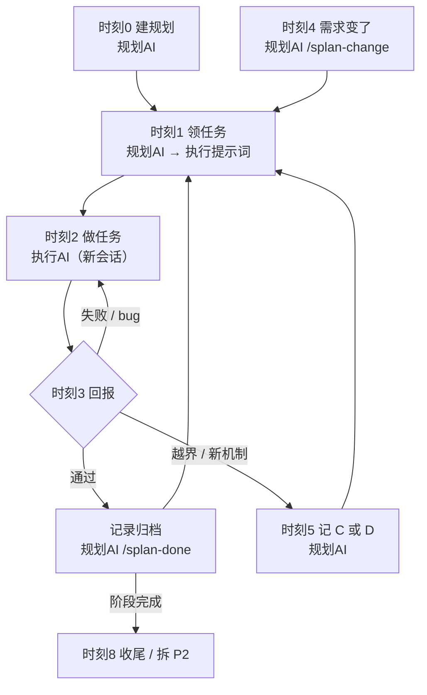
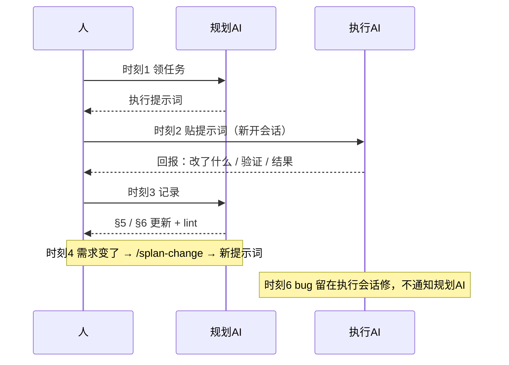

# 使用手册：怎么和 AI 说话

> 你只负责发提示词和判断；**规划AI 管"做什么"，执行AI 管"怎么做"**。
> 提示词全部可复制。【规划AI】【执行AI】表示发给哪个会话。

---

## 1. 三个角色

| 谁 | 干什么 | 不干什么 |
|---|---|---|
| **你** | 发提示词、做决策、验收 | 不用自己写任务记录 |
| **规划AI** | 拆任务、记变更、出执行提示词、收尾记录 | 不做实现；不问"要不要我来干"，直接出提示词 |
| **执行AI** | 只做一条任务、跑验证、按固定格式回报 | 不改规划文档、不 commit / push、不越界 |

加载 skill 后先自报角色（规划AI / 执行AI）。规划AI 只写规划文档并出提示词；执行AI 只改代码并回报，不动规划文档。

**正反例**

| 场景 | 反例 | 正例 |
|---|---|---|
| 用户对规划AI 说"顺手把这个做了" | 直接改代码、反问"要不要我来干" | 加任务，用 /splan-next 出提示词，实现交给执行AI |
| 执行AI 拿到一条 T2-x | 顺手修相邻问题、改 §5 / §0、commit | 只改本任务产出文件，跑验证，回报附 §5 记录 |

越界反例汇总见 `references/pitfalls.md` 的「角色越界（反例）」。

**文档是唯一事实源**。只在聊天里说的变更，下一个 AI 不知道。

---

## 1.1 硬规则：改完必须更新文档

没更新文档的"完成"不算完成。

| 谁 | 必须做 |
|---|---|
| **执行AI** | 回报里附一行**可直接粘贴的 §5 记录**（含验证、行为、结果） |
| **规划AI** | 每次回复末尾给**文档更新回执**：`§5 +1 / §6 +1 / §0 已同步 / 最后更新 / lint` |
| **人** | 看到回执里少项，直接让它补，别自己记 |

回执示例：

```text
文档更新：§5 +1（T1-2）｜§6 +1（T1-2 完成）｜§0 看板已同步｜最后更新 2026-01-01｜lint 0 error
```

`[x]` 只有在记录写入 §5 之后才能勾。

---

### 1.2 分支策略（D19）

- 执行AI 仅在用户明确要求时，基于当前分支新建 `<type>/<T#-#>-<任务简称>`；未指定则留在当前分支。
- `type` ∈ feature / bugfix / docs / refactor / chore。
- dirty / 非 git：执行AI 先停并报告，不新建分支。
- 规划AI 在当前分支提交；不自动 merge / push：merge 需显式要求，push 禁止。

## 2. 时刻表：什么时候发什么

### 时刻 0｜项目开工（初始化，不是规划）——【发给规划AI】

```text
你是本项目的规划AI。加载 skill Splan。

目标：<一句话>
仓库/路径：<一个或多个>
出口条件：<怎么算完，可以先空着>

请先按 references/recon.md 只读侦察，再建 / 更新规划文档：
1. 读 README / AGENTS / docs、构建文件、测试、入口、关键模块、git log
2. 只填 §0 基线、机制登记、§7 参考与索引
3. 需求登记和任务池留空
4. 报告你读到了什么（仓库 / 构建 / 测试 / 已有机制）
5. 不编造需求、不规划实现、不改代码
```

**你得到**：一个带基线、机制登记、代码索引的空规划；需求下一步用 `/splan-req` 进。

---

### 时刻 1｜每天开工 / 领下一条 ——【发给规划AI】

```text
你是规划AI。规划文档：<路径>。加载 skill Splan。

读 §0 看板、§1 任务池、§4 变更。
1. 未处理的变更先 /splan-change
2. 用 /splan-next 输出下一条任务的执行提示词
   - 任务必须有 `需求：R#` 和 `机制：复用 X / 新建 D#`
   - 会新建机制的任务，先在 §4 立 D 决策

只输出提示词，不做实现。本次只做一条。
回复末尾给文档更新回执。
```

**你得到**：一段"执行提示词"（这就是给执行AI 的任务）

---

### 时刻 2｜开始干活 ——【新开会话 → 发给执行AI】

```text
你是执行AI。只做下面这条任务，不做其他。开工前先 git status。

先读规划文档 §0 机制登记：已有机制就扩展它；要新建机制时先停下说"需要 D决策"。
需求超出任务边界（含引入新机制）时，先停下说"这需要记 C"。

<粘贴上一步的执行提示词>

结束时固定回复 5 行：
1. 改了什么
2. 验证（命令/人工）+ 结果
3. 行为变化：现在系统 / 界面实际会 …（给用户看）
4. 一条可直接粘贴到 §5 的记录：
   `- [x] **T1-x 名称** —— 改了什么；验证：命令 → 结果；行为：…；结果：通过`
5. 遗留问题

只给事实，下一步由规划AI 定。
```

**要点**：换一个会话做执行，不要和规划AI混在一个对话。

---

### 时刻 3｜执行AI 回报了 ——【发给规划AI】

```text
任务 <ID> 的执行回报如下：

<粘贴执行AI 的回复>

加载 skill Splan，/splan-done：
- 先审 diff（git status + git diff），只含本任务文件
- 按验证手段处理：
  - 命令：核对执行AI 回报的命令 + 结果，不重跑代码验证
  - 人工：把操作步骤发给用户，等用户按步骤确认；未确认只记“待确认”，不勾 [x]
- 把执行AI 给的记录行**原样**落到 §5，不要改写
- 命令通过 / 用户确认人工通过 → §5 一行（含"行为：…"）+ 归档 + §0 看板同步 + Splan lint
- 若任务 R 有 `文档`：按 obsidian.md 回写外部笔记——勾待办项；R 全部完成才置完成并写完成时间（带秒），未全完成只置进行；笔记缺失 / 找不到待办项记 WARN，不猜
- 命令不通过 → 记阻塞；人工未确认 → 记待确认，均不勾选
- 提交归属：规划AI 提交；执行AI 不提交。默认由规划AI 判断：本任务文件 + 验证通过 + 文档更新 + lint 0 才 commit；人工未确认不提交；`--commit` 强制提交、`--no-commit` 跳过；push 永不自动
- 回复末尾给文档更新回执
```

也可以直接：`/splan-done <路径> <任务ID>`（默认判断；`--commit` 强制提交、`--no-commit` 跳过）

---

### 时刻 4｜需求变了 ——【发给规划AI】

```text
需求变更：<一句话>
原因：<为什么>

加载 skill Splan，/splan-change：
1. 生成 C 号（不复用），定类型：新增 / 修改 / 删除 / 延期 / 否决 / 待定
2. 变更必须落到某个 R：`新增 R5` / `修改 R1` / `否决 R3`，同步更新需求登记状态
3. 影响五个面：任务 / 契约 / 测试 / 文档 / 机制
4. 更新任务池：
   - 新增 → 加任务，标 `需求：R#`
   - 修改 → 不改旧任务；新开"重做 T1-x（← C#）"，旧任务进归档标"取代"
   - 删除 / 否决 / 延期 → 移入归档，原文保留
5. 更新看板（活跃变更 / 最后更新）+ 跑 lint
6. 输出新的执行提示词
回复末尾给文档更新回执。
```

---

### 时刻 4b｜你自己改了需求 ——【一句话发给规划AI】

需求入口只有 §0 需求登记那一张表。你可以自己改；改完**分两种**：

| 你改了什么 | 要不要通知规划AI |
|---|---|
| 错别字 / 措辞 / 格式 / 顺序 | 不用 |
| 做什么 / 验收 / 范围 / 优先级 / 接口 | **要**，一句话 |

```text
我改了需求 R2：<改了什么>。
请加载 skill Splan，/splan-change（类型=修改，需求=R2）：
同步受影响的任务 / 契约 / 测试 / 机制，更新看板和需求登记状态，
然后输出新的执行提示词。回复末尾给文档更新回执。
```

**为什么必须通知**：范围变了，任务、机制、测试不跟着改，执行AI 又按旧的做。

---

### 时刻 5｜执行AI 说"超出边界" / "需要 D决策" ——【发给规划AI】

执行AI 会自动停。把它原话贴给规划AI：

```text
执行AI 报告：

<粘贴执行AI 的原话>

请 /splan-change 记 C（或立 D 决策），然后重新出执行提示词。
```

---

### 时刻 6｜发现 bug ——【留在执行AI 会话】

直接说，**不用告诉规划AI**：

```text
<描述现象>；这是实现细节，继续修当前任务。
```

修完让它按固定格式回报，走时刻 3。

---

### 时刻 7｜换会话 / 换 AI ——【发给新AI】

```text
加载 skill Splan，读规划文档 <路径>。

规划AI：/splan-enter --doc <路径>（复述阶段 / 下一条 / 活跃变更）
执行AI：直接粘贴 /splan-next 的执行提示词；不改规划文档。

先自报角色：规划AI 只出提示词、不做实现；执行AI 只做一条、不改规划文档。

事实源：代码 > 测试 > README/AGENTS > §0 看板。
当前阶段、下一条任务、活跃变更见 §0。

先复述：当前阶段 / 下一条任务 / 活跃变更。确认理解后再继续。
```

**要点**：先复述再干。复述错了立刻纠正，比干错了返工便宜。

---

### 时刻 8｜阶段收尾 ——【发给规划AI】

```text
阶段收尾。加载 skill Splan：
1. /splan-check（-Strict）
2. §0 看板全部完成；通用 frontmatter: status: done + completed；Obsidian: 状态=完成 + 完成时间（带秒）
3. §6 归档所有任务
4. 标"冻结：<阶段> @ <commit>（日期）"
5. 正文超 800 行就建 {同名}-P2.md，写血缘：前身 [[旧文档]]
回复末尾给文档更新回执
```

---

### 时刻 8.1｜整理文档 /splan-tidy ——【发给规划AI】

```text
整理规划文档。加载 skill Splan，用 /splan-tidy（可加 --doc <路径>）：
1. 默认内容整理：读代码 / 文档 → 找漂移 → 同步 §0 → 整理 §1/§4/§5/§6/§7
2. 合并重叠 R/T、去重、过期任务归档；合并按 D12（同类 R 并到最早 R，任务保留最早 ID）
3. 正文超 800 行：拆 {同名}-P2.md + 写血缘
4. --format：从磁盘重读最新 skill（优先仓库 SKILLS/splan），对比并迁移格式，不改语义
5. --all：内容整理 + 格式同步都做
6. 跑 lint；不改需求语义、不改代码、不 commit / push
回复末尾给文档更新回执。
```

---

### 时刻 9｜随时进需求 ——【发给规划AI】

需求随时会来，不需要一次想清楚。入口只有一个：

```text
新增需求：<一句话；不明确也照说>
请加载 skill Splan，用 /splan-req：
1. 先扫 §0 需求登记（R）、§1 任务池（T）、§4 D/C、§3 方案，查重复 / 冲突
   - 重复 → 按 D12 提议合并到最早 R，等确认，不静默合并
   - 冲突 → 报告目标 / 验收 / 范围 / 机制的冲突与取舍，等确认
2. 无重复 / 冲突再分配下一个 R 号，不重复
3. 明确 → R 待做，问是否现在拆任务
   不明确 → R 待澄清，生成一条探索任务（时盒 + 产出=结论 + 停止条件）
4. 关联现有 R / 机制，必要时先立 D
5. 更新需求登记和看板，跑 lint
6. 若传 `--doc <外部笔记>`：先按 obsidian.md 的笔记约定读入，登记 R + `文档` 列 + 拆任务；未传时行为不变；笔记缺失不猜，提示补
7. 输出下一条任务的执行提示词
回复末尾给文档更新回执。
```

也可以直接把需求写进 §0 需求登记表，再让规划AI 整理。

---

## 3. 需求怎么进（所有项目同一条路）

不区分项目类型。

1. 已有文档 → `/splan-req`
2. 没有文档 → 先 `/splan-new`（可以只建空骨架，需求后补）
3. 需求清楚 → `R 待做` + 拆任务
4. 需求不明确 → `R 待澄清` + 一条探索任务（时盒 / 产出=结论 / 停止条件）
5. 第一次接手已有仓库 → `/splan-new` 先读 `README` / `AGENTS` / `git log` 建基线，不编造需求

探索任务**不是特殊项目模式**，就是任务池里的一条任务：产出是结论 / 原型 / 数据，不是功能；方向由 D 锁定后再拆实现任务。

### 3.0 需求查重与冲突

- 每次 `/splan-req` 先扫 §0 需求登记（R）、§1 任务池（T）、§4 D/C、§3 方案
- 重复：按 D12 提议合并到最早 R，等用户确认；不静默合并
- 冲突：报告目标 / 验收 / 范围 / 机制冲突与取舍，等用户定
- 无重复 / 冲突才分配 R 号

### 3.1 方案讨论（§3）

- 方案只放 §3；任务行只留摘要；不另建方案文档
- 用户可改 §3；规划AI 以 §3 为准，/splan-next 先复述方案差异，冲突记 C，不覆盖用户编辑
- 讨论流程：规划AI 给 1–3 个选项 → 用户确认 → 落 §3

### 3.2 关联表与状态总览

- §1 顶部维护 R-T-D-C 关联表 / 状态总览：任务 / 状态 / 需求 / 决策 / 变更 / 记录；已完成与未完成同表
- 唯一排序源是 §1 任务池（P0→P1→P2，区内行序），关联表只是视图
- 重排任务记 C（修改），不改 ID、不动已完成；下一条 = P0 第一条
- §4 的 D / C 表填 `任务` 列回链 §1

### 3.3 需求外部笔记（`--doc`）

- `/splan-req --doc <外部笔记>`：按 `obsidian.md` 的笔记约定读入 → 登记 R + `文档` 列 + 拆任务
- 未传 `--doc`：行为不变
- 笔记缺失 / 格式不符：不猜，提示补
- 完成回写：`/splan-done` 勾待办项；该 R 全部任务完成才置完成并写 `完成时间`，未全完成只置进行；缺失待办项记 WARN

---

## 4. 命令快捷方式

命令 = 上面提示词的快捷键，效果一样。

| 命令 | 对应时刻 | 说明 |
|---|---|---|
| `/splan-new <标题> [--doc <路径>]` | 时刻 0 | 建骨架 |
| `/splan-req <需求> [--doc <路径>]` | 时刻 9 | 随时加需求 / 假设 |
| `/splan-next [<任务ID>] [--doc <路径>]` | 时刻 1 | 出执行提示词 |
| `/splan-done <任务ID> [--doc <路径>] [--commit / --no-commit]` | 时刻 3 | 审 diff、验证、更新 §5/§6/§0；默认判断提交 |
| `/splan-change <描述> [--doc <路径>]` | 时刻 4 | 记变更 |
| `/splan-check [--doc <路径>]` | 时刻 8 | 校验 |
| `/splan-enter [--doc <路径>]` | 时刻 7 | 进入规划AI |
| `/splan-tidy [--format / --all] [--doc <路径>]` | 时刻 8 / 随时 | 整理文档与格式 |

### 参数与自动定位

- **主对象在前**：需求 / 任务ID / 描述；`--doc <路径>` 可选。旧写法（路径在前）仍兼容。
- **自动定位顺序**（未传 `--doc`）：`--doc` → 第一个参数是存在的 `.md`（旧写法） → `AGENTS.md` 指针 → `PLAN.md` → `docs/plan.md` → 最近 `*.plan.md`（Obsidian 取最近含 `plan-doc:v1` 标记的笔记）。
- **多文档命中**：列出候选并询问，不猜。

| 命令 | 新写法（主对象在前） | 旧写法（兼容） |
|---|---|---|
| `/splan-new` | `<标题> [--doc <路径>]` | `<路径> <标题>` |
| `/splan-req` | `<需求> [--doc <路径>]` | `<路径> <需求>` |
| `/splan-next` | `[<任务ID>] [--doc <路径>]` | `<路径>` |
| `/splan-done` | `<任务ID> [--doc <路径>] [--commit / --no-commit]` | `<路径> <任务ID>` |
| `/splan-change` | `<描述> [--doc <路径>]` | `<路径> <描述>` |
| `/splan-check` | `[--doc <路径>]` | `<路径>` |
| `/splan-enter` | `[--doc <路径>]` | — |
| `/splan-tidy` | `[--format / --all] [--doc <路径>]` | — |

---

## 5. 一图流



谁和谁说话：



---

## 6. FAQ

**Q：bug 和需求变更怎么分？**
A：改"怎么做"是 bug，留在执行会话；改"做什么 / 验收 / 接口"是变更，发规划AI。不确定就发规划AI，记错可以删，漏记代价高。

**Q：执行AI 做一半会话断了？**
A：下次规划AI 的 /splan-next 会捞未完成项；§5 有 `进行中：卡在…` 记录。

**Q：两个执行AI 能并行吗？**
A：能，但任务边界和改动文件不能重叠。任务里写清"涉及文件"。

**Q：能不能直接跟规划AI 说"顺手把这个做了"？**
A：不能。规划AI 不做实现。让它加任务，再走时刻 1~2。

**Q：lint 一堆 WARN？**
A：WARN 是提醒不是门禁，回复里说明原因即可；ERROR 必须清零。
